<p align="center">
  
</p>

<p align="center">
  
</p>

<p align="center">
  
  
  
  
</p>

---

# VCite — AI Claim & Citation Verifier

**Sistem Validasi Deterministik Anti-Halusinasi AI**

- **Penyusun:** Sutan Lutfi Frank Richard (NIM: `26110300033`)
- **Program Studi:** Ilmu Komputer — Universitas Cakrawala
- **Mata Kuliah:** Software Development Fundamentals

---

## 1. Latar Belakang & Pendekatan Solusi
Model bahasa generatif (LLM) sering mengalami **halusinasi**, yaitu menghasilkan klaim, tahun, angka, atau kesimpulan yang terdengar meyakinkan tetapi tidak terdapat pada dokumen sumber asli (*Ground Truth*).

Alih-alih menggunakan AI lain untuk mengecek jawaban AI, **VCite** menerapkan pendekatan **deterministik** berbasis aturan rekayasa perangkat lunak:
1. **Sentence & Word Tokenization:** Memecah paragraf output AI menjadi kalimat tunggal dan menghapus tanda baca serta *stopwords*.
2. **Entity & Number Guard:** Mengekstrak entitas numerik (angka, tahun, persentase) pada klaim AI dan memvalidasi keberadaannya di teks sumber.
3. **Lexical Similarity Engine:** Menghitung skor kemiripan menggunakan **Cosine Similarity** terhadap setiap kalimat sumber.
4. **Deterministic Classifier:** Mengklasifikasikan klaim ke dalam `VERIFIED`, `PARTIAL_MATCH`, atau `UNSUPPORTED_CLAIM`.

---

## 2. Arsitektur Modular (*Separation of Concerns*)
Kode proyek dipisahkan secara tegas antara dokumentasi, logika inti (`src/core/`), antarmuka pengguna (`src/ui/`), dan pengujian otomatis (`tests/`):

```text
vcite-verifier/
├── docs/
│   ├── vcite-banner.svg        # Animated SVG hero banner
│   ├── SRS.md                  # Spesifikasi kebutuhan fungsional & non-fungsional
│   ├── sequence-diagram.puml   # Diagram interaksi antar-modul (PlantUML)
│   └── TEST_CASES.md           # Matriks skenario pengujian & status hasil
├── src/
│   ├── core/
│   │   ├── tokenizer.js        # Pemecahan kalimat & pembersihan stopwords
│   │   ├── entityGuard.js      # Ekstraksi & validasi entitas angka/tahun
│   │   ├── similarityEngine.js # Perhitungan Cosine Similarity & pencari kutipan
│   │   └── classifier.js       # Orkestrator penentuan status & ringkasan akurasi
│   └── ui/
│       └── cliDemo.js          # Layer presentasi CLI (terpisah dari logika core)
├── tests/
│   └── vcite.test.js           # Automated unit test (Node Native Test Runner)
├── package.json
└── README.md